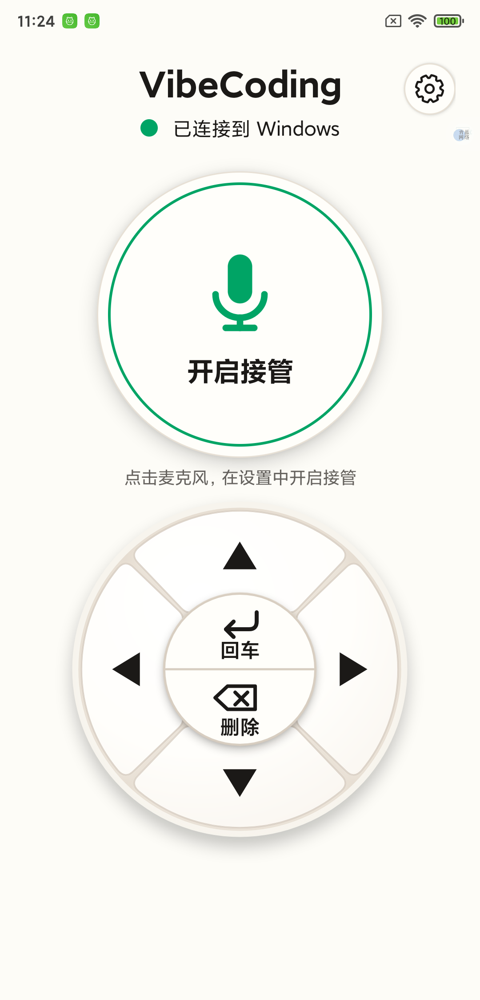

# VibeCoding 神器（Windows + Android）

用 Android 手机远程控制 Windows 输入：按住语音按钮说话，或用回车、删除和光标方向键。手机麦克风的声音送给电脑上的微信输入法。传输使用**经典蓝牙 RFCOMM/SPP**，不需要手机和电脑处于同一个 Wi-Fi。

```
Android 麦克风 ──蓝牙串口──> Windows 接收程序 ──播放──> CABLE Input
Android 快捷键 ──蓝牙串口──> Windows 接收程序 ──SendInput──> 电脑当前输入框
                                                  CABLE Output ──> 微信输入法麦克风
```

本仓库包含 Android App 源码、Windows 接收程序源码，以及已构建的 [Android 调试 APK](dist/PhoneVoiceRemote-debug.apk)。已在连接的 Android 测试机和当前 Windows 电脑上完成蓝牙连接、音频传送、长按快捷键及微信输入法转写实测。



本次界面以本地设计图 [已连接](design/vibecoding-remote-warm-v4-connected.png) 和 [已断开](design/vibecoding-remote-warm-v4-disconnected.png) 为基准实现。
方向轮盘采用四个独立的圆角扇形绘制，接缝和外沿由各按键自身的阴影形成；轮盘 View 四周预留阴影绘制空间，避免阴影在底部被矩形边界截断。

## 准备

- Windows 10/11 电脑，支持经典蓝牙 SPP；Android 8.0 以上手机。
- [VB-CABLE](https://vb-audio.com/Cable/)：电脑程序播放到 **CABLE Input**，微信输入法从 **CABLE Output** 录音。当前电脑已安装驱动；手机未开启接管时，Windows 默认使用原来的实体麦克风。驱动厂商要求安装后重启 Windows。
- Windows 端使用开源 PowerShell 模块 [AudioDeviceCmdlets](https://github.com/frgnca/AudioDeviceCmdlets) 切换默认录音设备。在新电脑上先运行 `Install-Module AudioDeviceCmdlets -Scope CurrentUser`；当前电脑已安装。
- Python 3.10 以上。
- 直接安装 APK 时无需 Android Studio。重新构建需要 Android SDK 35 和 JDK 17 以上；当前工作机已安装 SDK 35，仓库附有 Gradle 8.9 Wrapper。

## 构建手机 App

1. 将 `dist/PhoneVoiceRemote-debug.apk` 复制到手机安装。也可用 Android Studio 打开 `android/` 目录自行构建；在当前电脑上运行 `android/build-apk.ps1 -SdkPath <你的 Android SDK 路径>` 会重新构建并复制 APK 到 `dist/`。
2. 打开 App，允许“附近设备”和“麦克风”权限，保持页面打开。默认不接管电脑麦克风；点击右上角齿轮，在设置中开启“接管电脑麦克风”后才会切换。
3. 在手机和电脑的**系统蓝牙设置**中完成配对。App 不扫描设备，也不要求定位权限。

## 启动电脑程序

当前电脑已创建并安装了 Python 虚拟环境，接收程序在后台运行，登录 Windows 后会自动启动。其日志是 `pc/logs/receiver.out.log` 和 `pc/logs/receiver.err.log`。手动重启接收程序可在项目根目录运行 `pc/start_receiver.ps1`。

连接恢复：电脑额外安装了 `PhoneVoiceRemote-Receiver-Health` 计划任务，每分钟检查一次接收程序，意外退出时自动重启；手机 App 在蓝牙服务异常或发送失败后会自动重新监听。电脑检测到连续 10 秒没有手机保活帧时会重开 COM 端口。手机仍需保持 App 打开；若系统结束了 App 进程，需要重新打开。排查时查看 `pc/logs/receiver.out.log`、`pc/logs/receiver.err.log` 和 Windows 系统事件中的 `BTHUSB`。

在新电脑上，在项目根目录运行：

```powershell
python -m venv .venv
.\.venv\Scripts\python.exe -m pip install -r pc\requirements.txt
.\.venv\Scripts\python.exe pc\main.py --list-devices
.\.venv\Scripts\python.exe pc\main.py --list-ports
```

确认列表中有 `CABLE Input`。然后在 Windows 的“蓝牙和设备 → 设备 → 更多蓝牙设置 → COM 端口”中，给已配对手机添加一个**传出**端口，服务选 `PhoneVoiceRemote` 或 `Serial Port`。手机 App 应处于打开状态，以便 Windows 看见它的串口服务。当前电脑的测试手机已配对，传出端口为 `COM3`。

```powershell
.\.venv\Scripts\python.exe pc\main.py --port auto --hotkey Ctrl+Win
```

电脑程序会自动搜索蓝牙 COM 端口，并在断线时重连。连接后先在手机上开启“接管电脑麦克风”；Windows 默认录音设备会临时切到 CABLE Output。将光标放进微信输入框，**按住手机上的“按住说话”区域**；电脑会保持按住 `Ctrl+Win`，松开后释放快捷键并停止传音，微信输入法随后提交识别文字。这符合本机微信输入法显示的“长按 Ctrl+Win 可使用语音输入”。手机上点“语音快捷键”可改成其他输入法使用的组合键，例如 `Ctrl+Shift+V`；电脑的 `--hotkey` 是没有收到手机设置时的备用值。关闭手机开关、App 退到后台或蓝牙断线后，电脑恢复原来的录音设备；断线最长约 10 秒检测。可运行 `pc/check_cable.py` 验证 VB-CABLE 的实际音频回环。

手机主控区是居中的麦克风圆钮和方向轮盘。右上角齿轮可设置麦克风接管和语音快捷键；连接状态以绿色或红色圆点、麦克风图标及圆环提示。轮盘中心分成两个半圆：轻点上半圆执行回车，轻点下半圆执行删除；持续按住下半圆会连续删除。长按上半圆切换“选字模式”，此时用方向键选中文字，再按下半圆可删除选中内容。**方向键轻点移动一次，持续按住会连续移动，松手立即停止**。从一个按键滑向另一个按键会取消本次持续操作，减少误删。回车是否换行或发送消息取决于电脑应用的设置。

响应优化：Windows 串口按到达数据立即读取；手机按下说话按钮后先发送快捷键，再开始传音，首帧采用 5 ms 小包；录音器会在本次使用后保留供下一次复用，省去重复初始化。电脑接收程序会在新一轮语音开始时清除旧音频缓冲，并先注入快捷键再写日志。在当前测试机上，按下到快捷键写入蓝牙约 2–6 ms；复用录音器后，电脑收到首帧音频通常在快捷键后约 70–105 ms，首次启动可能更久。实际转写完成时间仍受蓝牙链路、虚拟声卡和微信输入法识别速度影响。

进一步的[分段延迟实测](pc/benchmark/README.md)表明，手机触摸到电脑执行快捷键的中位数约 19 ms，首帧声音约 0.1 秒到达电脑；微信语音提示约 0.54 秒才出现，说完后约 0.9–1.6 秒才提交完整文字。测试也验证了一个电脑本地流式识别模型能在中文测试句说完后约 0.15–0.19 秒给出最终结果，但它对技术英文词的识别尚不稳定。

### 可切换的极速本地识别

现在可在当前电脑上运行 `pc/start_receiver.ps1 -Mode local`，切换为电脑本地流式识别：**手机 App 无需重装**，手机音频仍走蓝牙，电脑跳过微信语音界面和 VB-CABLE，松开说话按钮后直接把识别文字输入当前光标处。切回原有微信输入法可运行 `pc/start_receiver.ps1 -Mode wechat`。电脑登录后自动启动、当前正在运行的均为微信模式。本地模式在真人使用时识别质量不佳，只保留作技术试验；它不显示微信的语音提示，也未自动补标点。

新电脑可用下面的命令准备本地模式（约 160 MB 模型，下载量约 127 MB）：

```powershell
python -m venv .venv-asr
.\.venv-asr\Scripts\python.exe -m pip install -r pc\requirements-local.txt
New-Item -ItemType Directory -Force pc\models | Out-Null
curl.exe -L 'https://github.com/k2-fsa/sherpa-onnx/releases/download/asr-models/sherpa-onnx-streaming-zipformer-zh-int8-2025-06-30.tar.bz2' -o pc\models\model.tar.bz2
tar -xf pc\models\model.tar.bz2 -C pc\models
.\pc\start_receiver.ps1 -Mode local
```

可用 `--dry-run` 只检查蓝牙帧，不播放声音或按键。可用 `--output` 指定其他虚拟音频播放设备名。

## 设计及限制

- 手机录制 16 kHz、16 位、单声道 PCM，首帧 5 ms，之后每 20 ms 通过蓝牙串口发送一帧。电脑扩展为 48 kHz 双声道并播放到 VB-CABLE。扩展使用简单的三倍采样重复，已在测试机上完成语音转写；音质和延迟随设备及蓝牙环境变化。
- 两端使用已配对的经典蓝牙串口；不支持只具备 BLE、没有 SPP 的设备。Windows 不一定自动创建传出 COM 端口，需要手动添加。此传输与蓝牙耳机的 HFP 麦克风模式不同，不能通过普通配对直接让手机变成 Windows 录音设备，因此仍需 VB-CABLE。
- 按键通过 Windows `SendInput` 注入到当前聚焦窗口。Windows 的权限隔离可能阻止它控制以更高权限运行的程序。语音区触发启动时指定的快捷键，快捷操作只发送固定的回车、退格、方向键及选择动作。
- 手机端保持页面打开并保持屏幕亮起；当前版本没有后台录音服务。手机停止或蓝牙断线后，电脑用保活帧检测并重连。
- 原始 16 kHz PCM 约 32 KB/s，加上帧头开销；蓝牙串口实际吞吐量和延迟取决于设备及驱动。若实测有断续，可改用 Wi-Fi/USB 传输或加入 Opus 压缩。

## 本地测试

```powershell
python -m unittest discover -s pc -p 'test_*.py' -v
```

## 参考项目和接口

- [Telepad](https://github.com/omsingh02/telepad)：Android 遥控键盘项目，说明蓝牙按键控制的产品方向。
- [AndroidMic](https://github.com/FEGO2006/tools-AndroidMic)：手机麦克风转电脑音频项目；其现有版本已移除蓝牙传输。
- [MicYou](https://github.com/LanRhyme/MicYou)：Android 麦克风与虚拟音频设备的现成方案，支持 Wi-Fi/USB/Web。
- [Android 蓝牙 RFCOMM 文档](https://developer.android.com/develop/connectivity/bluetooth/connect-bluetooth-devices)、[Windows 蓝牙驱动栈](https://learn.microsoft.com/en-us/windows-hardware/drivers/bluetooth/bluetooth-driver-stack)、[Windows SendInput](https://learn.microsoft.com/en-us/windows/win32/api/winuser/nf-winuser-sendinput)。

这些项目只作为方案参考，本仓库没有复制其源码。
